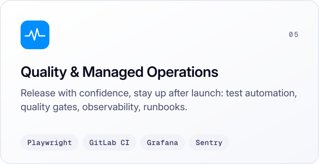
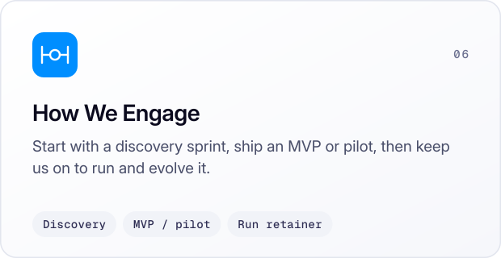
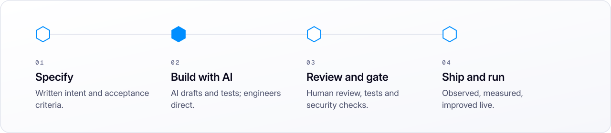
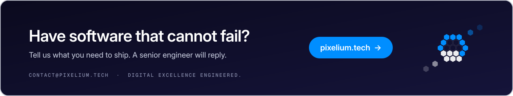

<picture>
  <source media="(prefers-color-scheme: dark)" srcset="assets/hero-dark.svg">
  
</picture>

<h3 align="center">Digital engineering for software that has to work.</h3>

Pixelium is a senior-led digital engineering firm for software where failure is expensive: 
payment flows, operator-scale digital channels, B2B commerce connected to ERP, 
and platforms that must be modernised without stopping the business.

         

 

## What we stand for

- **Built for high stakes.** Payments-grade discipline on every build: idempotent APIs, reconciliation, audit trails, observability.
- **Senior-led, AI-accelerated.** AI drafts, tests and documents. Senior engineers design, review and sign off.
- **Accountable from build to run.** Ops handover, monitoring and a run retainer after launch.
- **Governed by design.** Specification-driven delivery, quality and security gates, and data that stays under your control.

## What we engineer

<picture>
  <source media="(prefers-color-scheme: dark)" srcset="assets/card-01-dark.svg">
  
</picture>
<picture>
  <source media="(prefers-color-scheme: dark)" srcset="assets/card-02-dark.svg">
  
</picture>

<picture>
  <source media="(prefers-color-scheme: dark)" srcset="assets/card-03-dark.svg">
  
</picture>
<picture>
  <source media="(prefers-color-scheme: dark)" srcset="assets/card-04-dark.svg">
  
</picture>

<picture>
  <source media="(prefers-color-scheme: dark)" srcset="assets/card-05-dark.svg">
  
</picture>
<picture>
  <source media="(prefers-color-scheme: dark)" srcset="assets/card-06-dark.svg">
  
</picture>

## Industries

Financial services & payments &nbsp;·&nbsp; Telecom &nbsp;·&nbsp; Mobility & logistics &nbsp;·&nbsp; Consumer & digital products &nbsp;·&nbsp; Public, impact & enterprise

## How we engineer

AI accelerates every stage. Engineers own every decision.

<picture>
  <source media="(prefers-color-scheme: dark)" srcset="assets/how-we-engineer-dark.svg">
  
</picture>

 

<a href="https://pixelium.tech"><picture>
  <source media="(prefers-color-scheme: dark)" srcset="assets/contact-dark.svg">
  
</picture></a>

<a href="https://pixelium.tech"><b>pixelium.tech</b></a> &nbsp;·&nbsp; <a href="mailto:contact@pixelium.tech">contact@pixelium.tech</a> &nbsp;·&nbsp; Since 2017

Digital Excellence Engineered.

