<picture>
  <source media="(prefers-color-scheme: dark)" srcset="assets/hero-dark.svg">
  
</picture>

<h3 align="center">AI-first digital engineering, built for clients worldwide.</h3>

Pixelium is a digital engineering company that puts AI at the core of how software is conceived, built and run. 
We help ambitious organisations turn AI into production-grade products, platforms and operations: 
designed with intent, accelerated by AI agents, and owned end to end by accountable engineers.

         

 

## What we engineer

<picture>
  <source media="(prefers-color-scheme: dark)" srcset="assets/card-01-dark.svg">
  
</picture>
<picture>
  <source media="(prefers-color-scheme: dark)" srcset="assets/card-02-dark.svg">
  
</picture>

<picture>
  <source media="(prefers-color-scheme: dark)" srcset="assets/card-03-dark.svg">
  
</picture>
<picture>
  <source media="(prefers-color-scheme: dark)" srcset="assets/card-04-dark.svg">
  
</picture>

## How we build with AI

AI accelerates every stage of our delivery. People stay accountable for every decision.

<picture>
  <source media="(prefers-color-scheme: dark)" srcset="assets/how-we-build-dark.svg">
  
</picture>

- **Specs before code.** Every build starts from written intent and acceptance criteria that engineers and agents share.
- **Agents accelerate, engineers decide.** AI drafts, explores and tests. Experienced engineers design, review and sign off.
- **Quality is a gate, not a hope.** Automated tests, type checks and security scans must pass before anything ships.
- **Built to run.** We observe, measure and improve software in production, long after launch.

## Responsible by design

Your data stays yours. We design AI features with evaluation, access control, privacy and human oversight from day one, so they can be trusted in production, not just in a demo.

 

<a href="https://pixelium.tech"><picture>
  <source media="(prefers-color-scheme: dark)" srcset="assets/contact-dark.svg">
  
</picture></a>

<a href="https://pixelium.tech"><b>pixelium.tech</b></a> &nbsp;·&nbsp; <a href="mailto:contact@pixelium.tech">contact@pixelium.tech</a> &nbsp;·&nbsp; Global &nbsp;·&nbsp; Since 2017

Digital Excellence Engineered.

